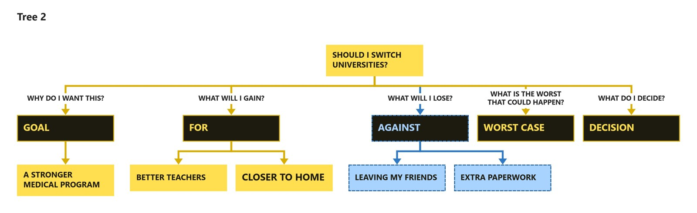
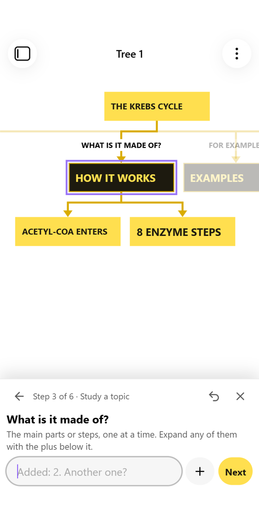
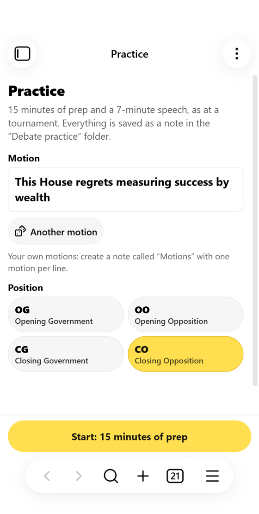

# Logic Tree

Think things through as a tree of questions, by tapping, on your phone or computer.

Logic Tree lets you turn a decision, a study topic or a debate motion into a tree of blocks. Each arrow carries a question, such as *Why is this happening?*, *What does it lead to?* or *What should be done?*, so every new block answers the question above it. The plugin picks the next question for you, lays the tree out by itself and learns from your corrections.



## What you can do

### Make a decision
Tap **Guide** and choose **Decision**, then write your question, for example *Should I switch universities?* The plugin works out the kind of decision and walks you through it step by step:

| Kind | Example | Steps |
|---|---|---|
| Yes or no | Should I…? | Goal, For, Against, Worst case, Decision |
| Choose between options | Berlin or Munich? | What matters, Options with pros and cons of each, Decision |
| Solve a problem | How do I stop procrastinating? | Problem, Causes, Ways, First step |

Pros show in yellow and cons in blue, so the balance is visible at a glance.

### Study a topic
Choose **Topic** and write the subject, for example *The Krebs cycle*. You answer six questions: what it is, why it matters, what it is made of, examples, connections, and what is still unclear. It works for exam prep, and also for explaining something to yourself before explaining it to others.



### Prepare a debate
Choose **Debate** and write a motion, for example *This House would ban cars from city centres*. Logic Tree supports British Parliamentary positions (OG, OO, CG, CO):
- Definitions, burden, frame, and the actors with what each gains or loses.
- Each argument broken into *why it is true → example → impact → why it outweighs*.
- Replies to the other side, and an extension for the closing benches.
- A 15-minute prep timer.
- **Speech plan** turns the tree into a note split by speaker.
- **Debate practice** gives you a random motion, 15 minutes of guided prep and a 7-minute speech with time marks. Each session is saved as a note.



### Everyday tree editing
- Tap a block to get pluses below it and beside it. Tap the selected block again to edit its text.
- The bottom-right key on the keyboard saves the block and starts the next one.
- Tap an arrow label to see every question at once. On desktop, press a digit key, or Alt plus a digit while typing.
- Press, hold and drag a block to move it under or beside another one.
- Collapse a branch, focus on one branch, merge branches into one block, or link blocks with an arrow.
- **Export to PDF** saves the whole tree as a one-page PDF next to the file.

## Getting started
1. Install **Logic Tree** from *Settings → Community plugins → Browse* and enable it.
2. Tap the **New tree** ribbon icon (on a phone it is in the menu at the bottom), or run the command **Logic Tree: New tree**.
3. Type your first thought, or tap **Guide** to be walked through a decision, a topic or a motion.

Help is always available in the tab's ⋮ menu under **How to use**.

## Files and privacy
- Trees are stored as `.tree` files (JSON) in your vault, next to your notes. Speech plans and practice sessions are ordinary Markdown notes.
- The plugin makes no network requests and collects nothing.

## Language
The interface is in English, with Russian available. By default it follows Obsidian's language; you can change this in *Settings → Logic Tree → Language*. Trees made in one language keep working in the other.

## Manual installation
Copy `main.js`, `manifest.json` and `styles.css` from the latest release into `<your vault>/.obsidian/plugins/logic-tree/`, then enable the plugin in *Settings → Community plugins*.

## Development
There is no build step: `main.js` is the source.
```bash
node --test tests/logic.test.js
```
`node tests/e2e-obsidian.js` drives a real Obsidian install on Windows with phone emulation. It uses a temporary profile and vault and leaves your own vault untouched.

## License
[MIT](LICENSE)

---

## По-русски

**Logic Tree** — деревья вопросов для решений, учёбы и дебатов на телефоне и компьютере. Каждая стрелка — вопрос, каждый блок — ответ на него.
- Кнопка **«Разбор»** проводит по шагам через решение («Стоит ли…», «Это или то», «Как решить проблему»), разбор темы или резолюцию в британском формате.
- В дебатах есть таймер подготовки, план речи по спикерам и тренажёр с резолюциями.
- Язык интерфейса меняется в *Настройки → Logic Tree → Язык*. Русский включается сам, если Obsidian на русском.
